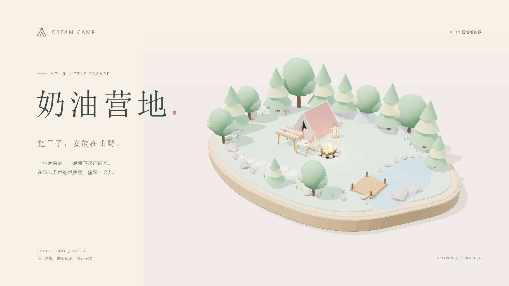
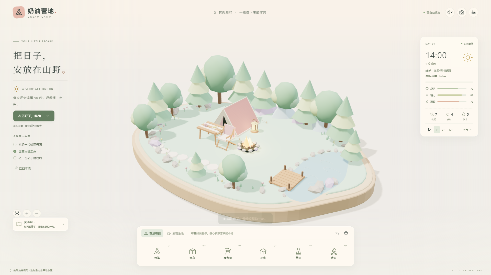

# 奶油营地 · 3D 露营模拟器



一个奶油色的小岛，一点慢下来的时光。森林湖畔、粉色帐篷、薄荷树木与暖黄营灯构成可旋转的微缩营地。

**[打开游戏，在线游玩](https://shuanglongdujian.github.io/cream-camp-3d/)**

在线版本由 GitHub Pages 托管，打开链接即可体验，无需下载源码。

## 运行

需要 Node.js（本机已使用 v24.15.0 验证）。下载或克隆本仓库后，在项目根目录打开终端：

```powershell
npm start
```

打开 http://127.0.0.1:4173 。无需 npm install，Three.js 已固定版本放在本地。请使用 HTTP 服务运行，不要直接双击 index.html；ES modules 需要正常的模块访问环境。

## 怎么玩

- 点击“开始露营”，一个露营日从 14:00 走到次日 08:00，正常速度约 12 分钟。
- 底部切换“营地布置 / 露营生活”。布置模式、菜单和后台页面会暂停模拟。
- 在布置栏选一件物品，再点草地放置；可旋转、移动、收起和撤回。达到数量上限时，点击工具栏会选中已有物件。
- 放置预览时支持方向键移动、R 旋转、Enter 确认、Esc 取消。空格在未聚焦按钮或输入框时切换暂停。
- 拖动空地旋转视角，滚轮或双指缩放；左侧取景按钮恢复默认视角。
- 用木柴点火和添柴，做饭需要食材、饮水及持续燃烧的营火；做好的料理需要点击吃饭。
- 捡柴需要等待且次数有限。桌面入口在左侧，手机入口在底部生活工具栏。
- 自然模式会经历多云与小雨。天幕的覆盖会改变遮雨效果、休息恢复与燃烧结果。可在设置中切换天气试验。
- 选择 1×、3×、10× 时间速度。音频需主动点击右上角声音按钮开启。
- 右上角相机导出场景 PNG；设置内可导出、导入 JSON 存档。照片只包含三维场景，不包含操作面板。

## 存档与边界

存档保存在当前浏览器，正常每 5 秒和关键操作后写入；切换/离开页面也会尝试保存。恢复后暂停等待玩家继续，离开时间不补算。清理浏览器数据、隐私模式或存储策略可能影响本地存档，请导出文件备份。

一张地图，六类设施，晴/阴/雨，昼夜、三项状态、资源与计时活动、日记和结算。当前没有角色漫游、游客经营、多人、账号或云同步。模型与声音都是原创程序内容，第三方仅使用 Three.js，详见 THIRD-PARTY.md。

## 验证

```powershell
npm test
npm run check
```

11 项模拟测试涵盖初始布局、遮雨差异、燃料、烹饪、资源不足、捡柴上限、暂停、时间步一致性、碰撞和存档校验。

浏览器已检查桌面 1440×1000、1280×900 与手机布局 390×844，验证放置/移动/撤回、点火/烹饪/吃饭、暂停、天气切换、刷新恢复、损坏存档与导入错误反馈、结算、照片下载和音频开关。结算使用临近结束的测试存档验证；手机为浏览器模拟，尚未做实体手机性能和音效听感验收。

封面和实际游戏截图保存在 docs/。



## 文件

- dist/index.html、style.css、main.js：界面和交互整合。
- dist/scene.js：Three.js 场景、物件、镜头、天气和动画。
- dist/simulation.js：纯函数模拟与存档校验。
- dist/audio.js：按需初始化的程序环境音。
- tests/simulation.test.mjs：模拟规则测试。
- server.mjs：只监听本机的静态服务。

制作日期：2026-10-24。后续可以扩展家具配色、日记故事、地图和钓鱼；优先根据试玩反馈修整现有循环。


本仓库保存可运行源码、测试与展示图片。浏览器游戏入口为 dist/index.html，通过本地 HTTP 服务运行。

## GitHub Pages 发布

源码保存在 main 分支，网页文件从 gh-pages 分支根目录发布。修改 dist 中的内容并提交后，使用下面的命令同步在线版本：

```powershell
git subtree push --prefix dist origin gh-pages
```

dist/.nojekyll 用于直接发布静态文件。游戏资源均使用相对路径，适配仓库的子目录地址。
